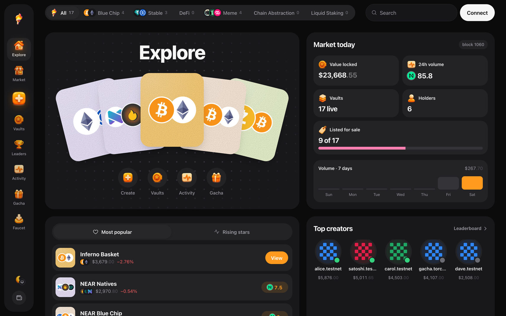
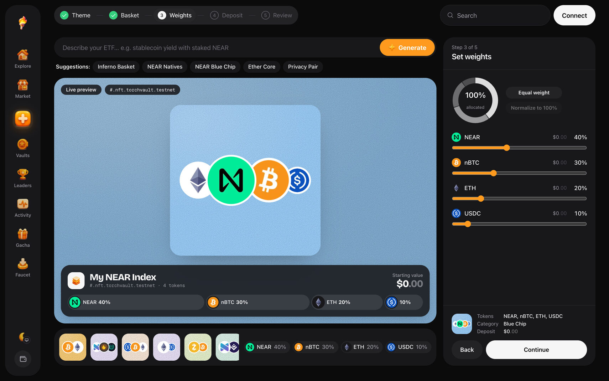
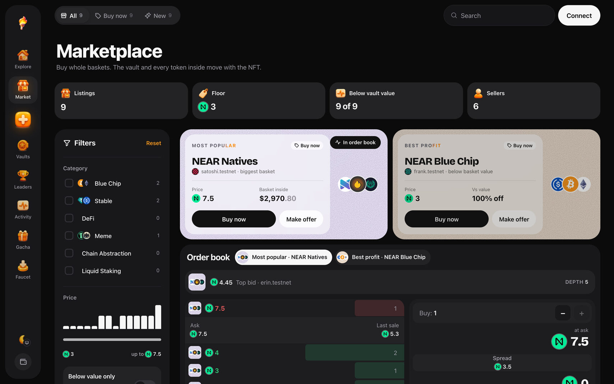
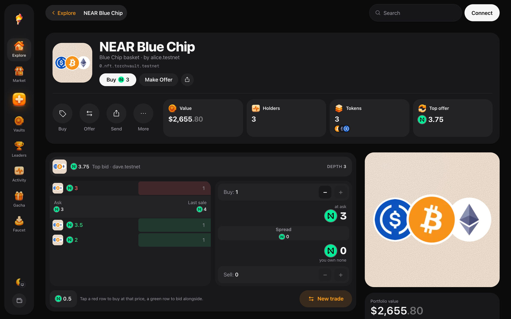
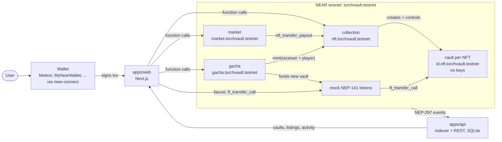
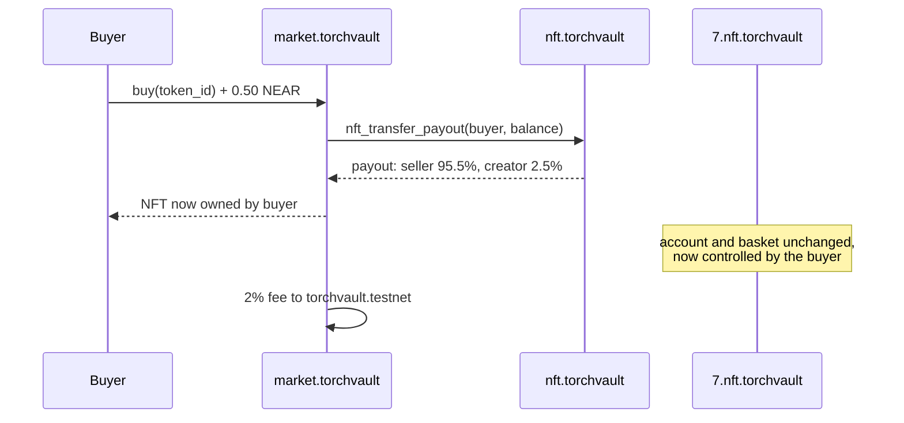

<p align="center">
  
</p>

<h1 align="center">Torch</h1>

<p align="center">
  NFTs that hold a basket of real tokens. Every NFT is its own NEAR account with zero access keys. Own the NFT, own the basket. Sell it, and the tokens move with it in one transaction.
</p>

<p align="center">
  <a href="https://torch-etf.vercel.app"></a>
  <a href="https://github.com/0xpochita/torch"></a>
  <a href="https://nearhackathon.com"></a>
  
  
  
  
  <a href="LICENSE"></a>
</p>

---

Torch turns an NFT into a **self-custodied index fund**. Every token minted by the collection gets its own NEAR sub-account (`<id>.nft.torchvault.testnet`) running an immutable vault contract with **no access keys**. The vault holds a basket of fungible tokens (BTC, ETH, stables, liquid staking, memes) and only obeys the collection, which only obeys the current NFT owner.

> **Sell the NFT, sell the basket.**
>
> - No wrapped receipt, no custodian, no "redeem" step: the basket lives in the NFT's own account
> - A sale moves the NFT and everything inside it in **one transaction**, with creator royalties and fees settled by `nft_transfer_payout`
> - Everything runs on **NEAR testnet** with mock NEP-141 tokens; only prices are off-chain



## For judges: try it in 5 minutes

Every step is "do X, see Y". Open **[torch-etf.vercel.app](https://torch-etf.vercel.app)** (or run it locally, see [Setup](#setup)). Contracts are live on NEAR testnet.

| # | Do | See |
|---|---|---|
| 1 | Open the app, click **Connect**, pick Meteor or MyNearWallet (testnet) | your account and NEAR balance in the top bar |
| 2 | **Faucet** → **Claim all ready** | 0.1 of each of 14 mock tokens in your wallet |
| 3 | **Create** → pick 3-4 tokens → set weights → **Mint ETF NFT** (step 1: mint, step 2: **Fund basket**) | a new NFT and its vault account `<id>.nft.torchvault.testnet` |
| 4 | Run `near account list-keys <id>.nft.torchvault.testnet network-config testnet now` | **no keys**: only the NFT can move the basket |
| 5 | Open the vault page → **List for sale** → set a price → **List vault** | the listing in **Market** and the order book |
| 6 | From a second account: **Buy now** | NFT and basket move to the buyer; 2.5% royalty to the creator, 2% fee, rest to the seller |
| 7 | **Gacha** → **Pull ×1** (0.1 NEAR) → tap the capsule | a freshly minted vault, already funded from the gacha treasury |
| 8 | **Activity** / **Leaderboard** | every event above, indexed from on-chain logs |

---

## What Makes Torch Special

### Who This Is For

Meet Dani. She bought an NFT for $4,199 last year. Today the floor is 0.72 NEAR. The picture is still there; nothing else is. There was never anything underneath it: no backing, no yield, just an image and a promise.

Dani does not need another JPEG. She wants to own something with real value inside, that she can still trade like an NFT: list it, sell it, gift it, and know that whatever is inside goes with it.

---

### The Problem

- **NFT value is a story, not a balance.** A floor price can go to zero because nothing backs the token
- **"Asset-backed" NFTs usually mean a custodian.** Someone else holds the assets and promises to redeem them
- **Wrapped receipts split ownership from the asset.** Sell the receipt and you still have to trust the redeem step
- **Index funds on-chain are vault shares, not things you can hold, show or trade one by one**

**How might we make an NFT that actually owns money, so that owning, selling or gifting the NFT moves the money with it, without anyone in the middle?**

---

### The Solution

NEAR accounts make this possible. Torch answers with four pieces.

**1. Every NFT is an account.** Minting creates `<id>.nft.torchvault.testnet` and deploys the vault as a **global contract by code hash** with zero access keys. Nobody holds a key to it, not even the creator.

**2. The basket lives in that account.** Deposits are plain `ft_transfer_call` into the vault. Withdrawals go through the collection and pay whoever owns the NFT at that moment.

**3. Trading moves the whole basket.** The market sells the NFT through `nft_transfer_payout`: the buyer gets the NFT and, with it, the account and every token inside. Creator royalty (2.5%) and market fee (2%) settle in the same transaction.

**4. A gacha that mints real vaults.** Each 0.1 NEAR pull rolls a rarity, mints a new vault to the player and funds it from the gacha treasury.

---

## Features



- **Create A Vault**: pick up to 6 tokens, set weights, mint; the vault account is created on-chain
- **Deposit / Withdraw**: top up any basket token, or withdraw to the current owner
- **Vault Page**: basket, value, holders, account details and history
- **Marketplace**: listings in NEAR, filters by category, featured baskets
- **Order Book**: asks, bids and spread per vault; tap a row to buy or bid
- **Offers**: escrowed NEAR offers; the owner accepts with one approval
- **Royalties**: 2.5% to the creator through NEP-199 `nft_payout`
- **Gacha**: 1-pull or 10-pull, rarities 60/28/10/2, pity at 50, funded from a treasury
- **Faucet**: 0.1 of each mock token per hour, plus NEAR wrapping
- **Activity & Leaderboard**: every event indexed from NEP-297 logs
- **Any NEAR Wallet**: Meteor, MyNearWallet, Intear, Nightly, Ledger and more via near-connect



---

## NEAR Integration

What NEAR enables here, concretely:

| NEAR feature | How Torch uses it |
|---|---|
| **Named sub-accounts** | One account per NFT, derivable offline: `vault_of(token_id)` = `<id>.nft.torchvault.testnet`. Nobody else can create a look-alike |
| **Global contracts (by hash)** | Every vault runs the same immutable code, published once; minting a vault costs storage only |
| **Accounts without keys** | Vaults have zero access keys, so only contract logic can move their funds |
| **NEP-171 / 177 / 178 / 181** | Standard NFT core, metadata, approvals and enumeration: any NEAR wallet and marketplace understands the token |
| **NEP-199 payouts** | `nft_transfer_payout` settles price, royalty and fee in the sale transaction |
| **NEP-141 / 145** | Basket tokens, storage registration and `ft_transfer_call` deposits |
| **NEP-297 events** | `vault_created`, `vault_deposit`, `sale`, `gacha_pull` and more feed the indexer |
| **near-connect** | One wallet picker for every NEAR wallet |

### Contracts (NEAR testnet)

| Account | Contract | Role |
|---|---|---|
| `torchvault.testnet` | none | Deployer, admin, 2% market fee receiver |
| `nft.torchvault.testnet` | [`collection`](monorepo/contracts/collection) | Permissionless mint; creates each vault; the only authority over vaults; 2.5% creator royalty |
| `<id>.nft.torchvault.testnet` | [`vault`](monorepo/contracts/vault) | Holds the basket; global contract by code hash; no access keys |
| `market.torchvault.testnet` | [`market`](monorepo/contracts/market) | NEAR listings, escrowed offers, sales via `nft_transfer_payout` |
| `gacha.torchvault.testnet` | [`gacha`](monorepo/contracts/gacha) | 0.1 NEAR pulls, rarity 60/28/10/2, pity 50; mints and funds a vault |
| `tusdc`, `tusdt`, `tbtc`, `teth`, `thot`, `trhea`, `tlinear`, `tstnear`, `tzec`, `taurora`, `tnpro`, `tdragon`, `tshitzu`, `tsweat` `.torchvault.testnet` | [`mock-ft`](monorepo/contracts/mock-ft) | Basket tokens with a rate-limited faucet |
| `wrap.testnet` | existing wNEAR | NEAR inside baskets |

Method names, JSON shapes and events: [`contracts/INTERFACES.md`](monorepo/contracts/INTERFACES.md).

### Security model

A buyer must be able to trust that the basket they pay for cannot be pulled out from under them. The collection enforces nine invariants:

| # | Invariant |
|---|---|
| I1 | A vault has no access keys and its code cannot change (global contract by hash) |
| I2 | A vault moves funds only when called by the collection |
| I3 | Only the collection can initialise a vault |
| I4 | A token exists only if its vault exists |
| I5 | Withdrawals pay the owner at call time; the token cannot move until the withdrawal resolves |
| I6 | A listed token (any approval) cannot be withdrawn from |
| I7 | A token in `nft_transfer_call` is locked until it resolves |
| I8 | Locked tokens cannot be transferred, sold or approved |
| I9 | Unlock callbacks never panic |

Audit findings and their fixes, with reproductions: [`contracts/AUDIT.md`](monorepo/contracts/AUDIT.md). Gacha randomness uses `env::random_seed`, fine for testnet; mainnet needs commit-reveal or a VRF.



---

## Architecture

### System Flow



Writes go straight from the wallet to the contracts. Reads (lists, history, NAV, leaderboard) come from the indexer, which follows blocks, parses the `torch` events and refreshes vault balances over RPC.

### Buy Flow



---

## Tech Stack

| Layer | Technology |
|---|---|
| Smart contracts | Rust, near-sdk 5.30, near-contract-standards, cargo-near |
| Contract tests | Unit tests and near-workspaces sandbox tests (132 Rust tests) |
| Frontend | Next.js 16 (App Router, React Compiler), React 19, TypeScript, Tailwind CSS v4 |
| Wallets | @hot-labs/near-connect, near-api-js 7 |
| 3D / Motion | three.js (gacha machine), Motion |
| Icons | Phosphor Icons, custom 3D icons |
| Indexer / API | Hono on Node 22, built-in `node:sqlite`, neardata.xyz blocks with RPC fallback |
| Scripts | near-cli-rs deploy script, TypeScript seeder |
| CI | GitHub Actions |
| Built with | AI-assisted development, Orca worktrees; launch video with Remotion and ElevenLabs |

---

## Setup

### Requirements

- Node 22, [pnpm](https://pnpm.io) 10
- A NEAR testnet account in any wallet (fund it from the testnet faucet)
- For contracts only: Rust stable, `wasm32-unknown-unknown`, `cargo near`, near-cli-rs

### Run the app

```bash
git clone https://github.com/0xpochita/torch.git
cd torch/monorepo
pnpm install

# web: testnet contract ids are already in the example
cp apps/web/.env.example apps/web/.env.local
echo "NEXT_PUBLIC_VAULT_CODE_HASH=HeRTap1dvgDJYrK6GdydHPzswFuEmxUgNnAqRGDmd811" >> apps/web/.env.local

# api: index the live contracts from their deploy block
cp apps/api/.env.example apps/api/.env
echo "START_HEIGHT=276570933" >> apps/api/.env

pnpm dev:api        # indexer + REST on :8787 (first start backfills from START_HEIGHT)
pnpm dev:web        # http://localhost:3000
```

No network? `pnpm --filter api fixture` serves synthetic indexed data on :8787 so every page renders.

### Contracts

```bash
cd monorepo/contracts
cargo test                          # unit + sandbox tests
cargo near build non-reproducible-wasm
```

Deploying your own copy: [`scripts/README.md`](monorepo/scripts/README.md) (`scripts/deploy-testnet.sh`, try `DRY_RUN=1` first) and the NEAR budget in [`scripts/budget.md`](monorepo/scripts/budget.md).

### API endpoints

| Endpoint | Returns |
|---|---|
| `GET /vaults` · `GET /vaults/:id` | Vaults with basket, NAV and history |
| `GET /market/listings` · `GET /market/orderbook/:id` | Listings and per-vault order book |
| `GET /offers` | Open offers |
| `GET /activity` | Indexed events |
| `GET /leaderboard` | Creator leaderboard |
| `GET /gacha/recent` · `GET /stats` · `GET /health` | Recent pulls, totals, indexer height |

---

## Repository Layout

```
monorepo/
├── contracts/        Rust: collection, vault, market, gacha, mock-ft, integration + audit tests
├── apps/web/         Next.js app (Explore, Create, Vault, Market, Gacha, Faucet, Activity, Leaderboard)
├── apps/api/         Indexer + REST API (Hono, SQLite)
├── scripts/          Testnet deploy and seed
├── skills/           NEAR agent skills used while building
└── docs/             Demo script
```

---

## Hackathon Notes

- **Built during NEAR HACKATHON.** The first commit is from 2026-11-05, inside the hackathon window (it opened with the announcement on 2026-10-19); there is no pre-hackathon baseline.
- **Libraries and templates (Q-005):** near-sdk, near-contract-standards, near-workspaces, @hot-labs/near-connect, near-api-js, Next.js, Hono, three.js, Motion, Phosphor Icons. The NFT-as-account pattern follows the `near-nft-account` skill in [`monorepo/skills`](monorepo/skills). Code was written with AI assistance.
- **Testnet only (Q-010):** all contracts and tokens live on NEAR testnet; basket tokens are mocks with a faucet.

---

## License

[MIT](LICENSE)
