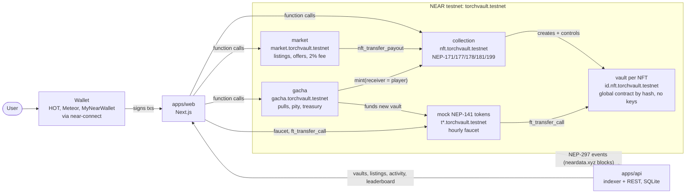

# Torch: the NFT that is a vault

Torch turns an NFT into a self-custodied index fund. Every token minted by the collection gets its
own NEAR account (`<id>.nft.torchvault.testnet`) running an immutable vault contract with **no
access keys**; the vault holds a basket of fungible tokens (BTC, ETH, stables, memes, liquid
staking, ...) and only obeys the collection, which only obeys the current NFT owner. Holding the
NFT means owning the basket: deposit into it, withdraw from it, and when you sell the NFT on the
market (or win it from the gacha), the basket changes hands with it in one transaction. No wrapped
receipts, no custodian, no "redeem" step: **sell the NFT, sell the basket**.

Built for the NEAR "NFTs That Do Something" track. Everything runs on NEAR testnet with mock
NEP-141 tokens; only prices are off-chain.

## Architecture



Writes go straight from the wallet to the contracts; reads (lists, history, NAV, leaderboard) come
from the indexer, which follows blocks, parses the `torch` events and refreshes vault balances
over RPC.

## Contracts (NEAR testnet)

| Account | Contract | Role |
| --- | --- | --- |
| `torchvault.testnet` | none | deployer, admin, 2% market fee receiver |
| `nft.torchvault.testnet` | [`collection`](contracts/collection) | permissionless mint; creates each vault; the only authority over vaults; 2.5% creator royalty (NEP-199) |
| `<token_id>.nft.torchvault.testnet` | [`vault`](contracts/vault) | holds the basket; global contract by code hash; no access keys |
| `market.torchvault.testnet` | [`market`](contracts/market) | NEAR listings and escrowed offers, sales via `nft_transfer_payout` |
| `gacha.torchvault.testnet` | [`gacha`](contracts/gacha) | 0.1 NEAR pulls (10-pull 0.9), rarity 60/28/10/2, pity 50; mints and funds a vault from its treasury |
| `tusdc`, `tusdt`, `tbtc`, `teth`, `thot`, `trhea`, `tlinear`, `tstnear`, `tzec`, `taurora`, `tnpro`, `tdragon`, `tshitzu`, `tsweat` `.torchvault.testnet` | [`mock-ft`](contracts/mock-ft) | basket tokens with a rate-limited faucet |
| `wrap.testnet` | existing wNEAR | NEAR inside baskets |

Method names, JSON shapes and events are fixed in `contracts/INTERFACES.md`.
Build and test: [`contracts/README.md`](contracts/README.md).

## Security model

A buyer must be able to trust that the basket they pay for cannot be pulled out from under them.
The collection enforces nine invariants from
[`skills/near-nft-account`](skills/near-nft-account/SKILL.md):

| # | Invariant |
| --- | --- |
| I1 | A vault has no access keys and its code cannot change (global contract by hash) |
| I2 | A vault moves funds only when called by the collection |
| I3 | Only the collection can initialise a vault |
| I4 | A token exists only if its vault exists |
| I5 | Withdrawals pay the owner at call time, and the token cannot move until the withdrawal resolves |
| I6 | A listed token (any approval) cannot be withdrawn from |
| I7 | A token in `nft_transfer_call` is locked until it resolves |
| I8 | Locked tokens cannot be transferred, sold or approved |
| I9 | Unlock callbacks never panic |

Vault ids are sub-accounts of the collection, so nobody else can create a look-alike, and clients
derive `vault_of(token_id)` offline. Check I1 yourself:
`near account list-keys 0.nft.torchvault.testnet network-config testnet now` must list nothing.
Findings and fixes: [`contracts/AUDIT.md`](contracts/AUDIT.md). Gacha randomness uses
`env::random_seed`, which is fine for testnet; mainnet needs commit-reveal or a VRF.

## Local dev quickstart

Needs node 22 and pnpm 10.

```bash
cd monorepo
pnpm install
pnpm --filter api fixture   # API on :8787 with synthetic indexed data, no network needed
pnpm dev:web                # Next.js app; copy apps/web/.env.example to apps/web/.env.local first
```

Against testnet instead: `pnpm dev:api` reads `apps/api/.env` (written by the deploy script) and
indexes the real contracts. Contracts need Rust stable with `wasm32-unknown-unknown` and
`cargo near`: see [`contracts/README.md`](contracts/README.md).

## Testnet run order

Fund `torchvault.testnet` → `scripts/deploy-testnet.sh` (try `DRY_RUN=1` first) →
`scripts/seed-testnet.ts` → API indexer from the deploy's `START_HEIGHT` → web. Step by step,
with the NEAR budget: [`scripts/README.md`](scripts/README.md) and
[`scripts/budget.md`](scripts/budget.md).

## Getting test tokens

1. Create a testnet account in any NEAR wallet (HOT, Meteor, MyNearWallet) and fund it from the
   NEAR testnet faucet.
2. Open the app's **Faucet** page ([`/faucet`](apps/web/src/app/faucet/page.tsx)), connect, and
   claim 0.1 of each mock token (once per token per hour; the first claim also pays the 0.00125
   NEAR storage deposit). Wrap NEAR into wNEAR from the same page.
3. Create a vault on **Create**, or pull the gacha for a pre-filled one.

## Demo

3-minute walkthrough script: [`docs/demo-script.md`](docs/demo-script.md).
